# 🎮 UnPdeC
## 尝试解压.pde资源文件，尝试理解VFS的工作机制与逻辑！

## 🛑 声明&警告
    此项目是Unpde(c#)的替代项目
    使用 CatPaw, 腾讯元宝, Kimi, Claude, DeepSeek, Trae ,CodeBuddy, QWen, JoyCode, GLM5.0 等AI 辅助开发
    为了学习编程和加解密算法而研究
    本项目严禁用于商业目的，仅为学习交流！！！
    我不会对任何因使用本项目而造成的损失负责！！！

    尘世喧嚣，唯此方寸之间，
    曾有星辰，落于指尖。
    那些年，光影流转，
    青春如梦，岁月如歌。
    然星辰陨落，世界崩塌，
    寂静无声，空留余温。
    心之所向，素履以往，
    逆流而上，破茧成蝶。
    零壹之境，代码荒原，
    千回百转，矢志不渝。
    不为功名，只为初心。
    此物虽微，承载万千，
    虽不完美，却见真心。
    愿此微光，照亮归途，
    愿逝去的时光，重现光芒。
------------

#  📝 笔记本
    现状:
        mesh skel anim 可以用FCM2/FMC转换成smd格式！

        目前可以将 明文lua 转换为 二进制luac文件
        将二进制luac 转换为 游戏中能用的lua文件

        可以将任意文件转换为 游戏中能用的.cache文件

        可以将 任意目录(.cache资源目录) 转换为 .pde文件！

------------

# 🚀 使用指南

- 确保系统安装了 Visual C++ 运行时库。你可以从[这里](https://aka.ms/vs/17/release/vc_redist.x64.exe)下载安装。

- 将 [FastXOR.exe](Release/FastXOR.exe) 和 [UnPdeC.exe](Release/UnPdeC.exe) 放置于包含 `.pde` 文件的目录中。

- 将 `.pde` 文件拖拽到 `FastXOR.exe` 后将对文件进行异或操作，生成对应的 `.xor` 文件。

- 运行 `UnPdeC.exe`，选择几个解压选项后，会将 `.xor` 文件进行对应的解包操作。

- 推荐解压选项为 混合模式！这样有利于后期的折腾！

---

# 🔨 Build

    IDE: VS2026
    平台: Windows X64
    C++标准: C++20
    文件编码: UTF-8(BOM)

---

# 🐻线🐺C🐱L🐶U🦊E🐮索🐰

## 🍰.pde文件数据结构

    .pde文件是一个虚拟文件系统(VFS)
    我们打开它就等于在剥壳或者在拆包装！
    
    最外层：
        .pde文件用HxD这样的16进制编辑器打开后，没有能看懂的数据！
        这是由于数据被XOR异或了一遍，使用了0x1000的XOR密钥，
        也就是说我们可以用这个密钥从头到尾循环异或一遍即可将最外层的数据解开！
        这样使用HxD打开后，就可以看懂一些数据了！

    第二层：
       这里有VFS表的数据(在下方有详细的分析)和文件/文件夹的描述信息！
       和各个文件被压缩后的数据(有的散落在各处)

       其中目录/文件的结构是嵌套的，有关联的。
       根目录位置在 0x1000 ,其中包含了很多文件和文件夹的描述信息！
       每个描述信息大小为 0x80字节，其中包含了 类型，名称，修改时间，偏移值，大小！

       偏移值是需要在经过计算后才能得到真实偏移值。
       有些文件大小在大于0x1000字节时，数据的存储可能不是连续的！
       所以大于0x1000字节的数据需要动态计算后续数据存储的真实偏移值。
    
    第三层:
       通过第二层获取到的.cache文件还需要再解压一次！
    
    第四层:
       .dds .tag .swf等文件 删除前8字节后可以直接预览！
       .lua 需要使用 unluac.exe 将二进制的lua转换为明文lua。
       .pd9 .vd9需要 HlslDecompiler 反编译为HLSL代码。
       .mesh .skel .anim 文件需要 PdeModelTools 导入到Blender中才能预览。
       (.skel .anim 正在探索中)

## 🌳根目录

使用 [HxD](https://mh-nexus.de/en/hxd/) 打开.xor/.pde文件
并转到 0X1000

## 📄文件/📁文件夹 描述信息

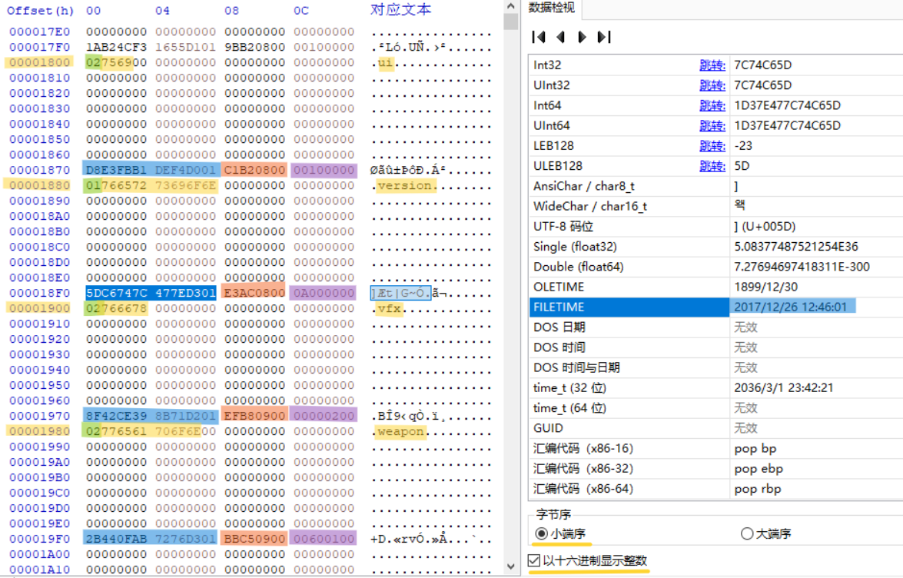

    每组大小: 
        0x80字节

    类型 (绿色):
        位置: 0X00
        长度: 0X01
        定义: 01 = 文件 , 02 = 目录

    文件名 (黄色):
        位置: 0X01开始
        长度: 遇到00为止
        定义: 文件名/文件夹名

    NTFS Time/Windows FileTime（蓝色）：
        位置: 0X70-0x77
        长度: 0X08
        定义: Windows NTFS时间
        备注: 需要转换成小端序,
            在HxD中只要选中后即可在右侧看到FILETIME
            也可在线寻找NTFS Time Converter/Windows FileTime Converter进行在线转换

    偏移值 (橙色):
        位置: 0X78-0X7B
        长度: 0X04
        定义: 此文件/文件夹在.pde文件中的"实际"偏移值
        备注: 此偏移值还需要经过转换后才是实际的偏移值。

    大小 (紫色):
        位置: 0X7C-0X7F
        长度: 0X04
        定义: 此文件/文件夹在.pde文件中的占用的实际字节大小

## 🔑 .cache文件中需要二次解密的数据分析

    每个后缀为.cache的文件在0x18位置都会有一个标志位
    这个标志位目前观察到的作用是判断是否需要参与二次解密
    以及会影响解码后数据大小的位置

### 6D标志(需要二次解压)

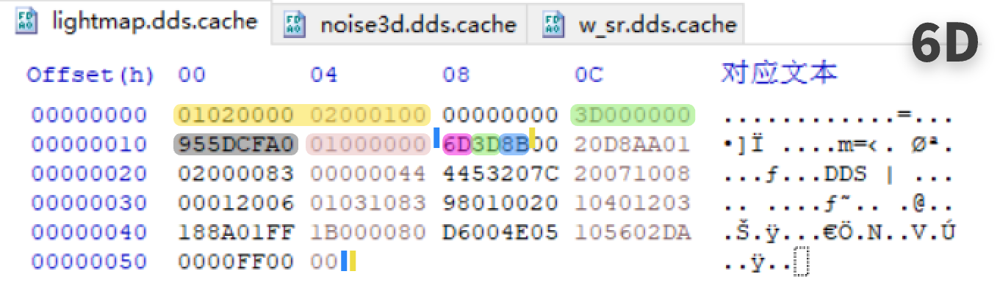

    01020000 02000100 : 文件类型标识(后缀或类型不同则值不同)
    
    00000000 -> 0X0 : 未知

    3D000000 -> 0X3D : 从0X18(蓝竖线)开始到结尾区间数据大小

    955DCFA0 -> 0xA0CF5D95 : CRC校验码(可以用VerifyCRC计算)

    01000000 -> 0X1 : 文件数量?

    6D -> 解压方式标识,表示需要二次解压,且从0x18到结尾的内容小于0x6D！

    3D -> 0X3D : 从0X18(蓝竖线)开始到结尾区间数据大小！由于解压方式标识是6D,所以这里的值是单字节的！
    
    8B -> 0X8B : 参与二次解压后的数据大小

    黄色竖线 : 从0x1B开始到结尾的数据是实际参与解压的数据！

    解压后的文件 : 前8字节是 文件类型,大小/数量, 删除后即可正常预览！

### 6E标志(不需要二次解压)

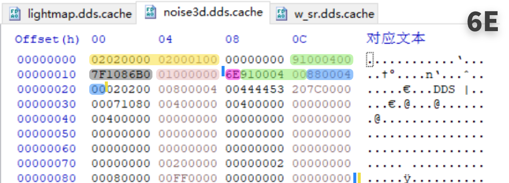

    02020000 02000100 : 文件类型标识(后缀或类型不同则值不同)
    
    00000000 -> 0X0 : 未知

    91000400 -> 0X40091 : 从0X18(蓝竖线)开始到结尾区间数据大小

    7F1086B0 -> 0xB086107F : CRC校验码(可以用VerifyCRC计算)

    01000000 -> 0X1 : 文件数量?

    6E -> 解压方式标识,表示不需要二次解压!!!直接可以从0x21到结尾的数据导出,且不关乎于0x18到结尾的数据大小！

    91000400 -> 0X40091 : 从0X18(蓝竖线)开始到结尾区间数据大小！由于解压方式标识是6E,所以这里的值是4字节的！
    
    88000400 -> 0X40088 : 参与二次解压后的数据大小

    黄色竖线 : 从0x21开始到结尾的数据是实际参与解压的数据！

    解压后的文件 : 前8字是 文件类型,大小/数量, 删除后即可正常预览！

### 6F标志(需要二次解压)

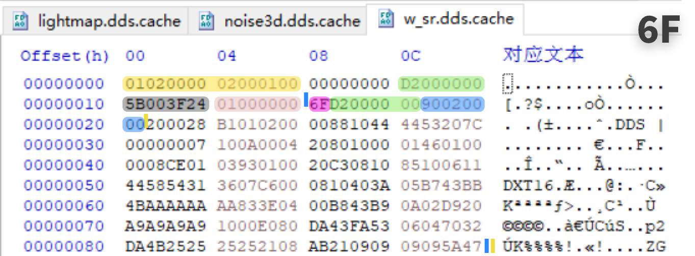

    01020000 02000100 : 文件类型标识(后缀或类型不同则值不同)
    
    00000000 -> 0X0 : 未知

    D2000000 -> 0XD2 : 从0X18(蓝竖线)开始到结尾区间数据大小

    5B003F24 -> 0x243F005B : CRC校验码(可以用VerifyCRC计算)

    01000000 -> 0X1 : 文件数量?

    6F -> 解压方式标识,表示需要二次解压,且从0x18到结尾的内容大于0x6F！

    D2000000 -> 0XD2 : 从0X18(蓝竖线)开始到结尾区间数据大小！由于解压方式标识是6F,所以这里的值是4字节的！
    
    90020000 -> 0X290 : 参与二次解压后的数据大小

    黄色竖线 : 从0x21开始到结尾的数据是实际参与解压的数据！

    解压后的文件：前8字节是文件类型、大小/数量，删除后即可正常预览。

### 特殊的.lua文件
    发现AS中的 .lua 没有 这些标记！
    在.xor文件中存储的就是 luac 字节码数据！
    没有上面所说的那些头数据!

    OFFSET    00       04       08       0C        ASCII
    00000000  1B4C7561 51000104 04040800 19000000  .LuaQ........... 
    00000010  402F7363 72697074 732F6176 745F7368  @/scripts/avt_sh 
    00000020  61646F77 2E6C7561 00000000 00000000  adow.lua........ 
    00000030  00000143 FFA50200 00054000 00064040  ...C......@...@@ 
    00000040  0045C000 001C4000 01010001 004A0000  .E....@......J.. 
    00000050  008A0000 00CA0000 000A0100 00454101  .............EA. 
    00000060  00818101 00C1C101 00010202 005C8100  .............\.. 

------------

## VFS表/VFSTable

### 计算VFS表偏移的方法
从FC1.0.6.8166版本的 0x00BAF700处的方法中获取到了如何计算VFS表偏移的逻辑！
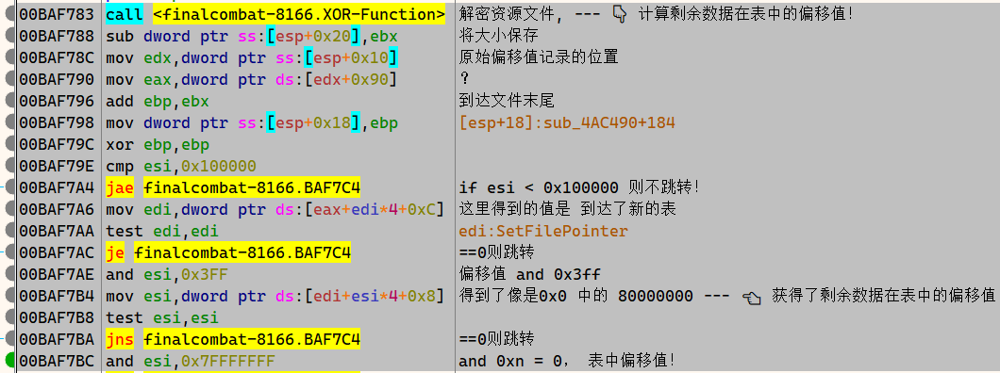

### .pde文件的结构
    [
        {
            表: [0x1000字节(4kB)]
            内容: [0x400000字节(4MB)]
        },
        {
            表: [0x1000字节(4kB)]
            内容: [0x400000字节(4MB)]  
        },
        {
            表: [0x1000字节(4kB)]
            内容: [0x400000字节(4MB)]  
        }
    ]

### 表数据解读
    OFFSET    00       04       08       0C        ASCII
    00000000  00000080 00000080 00000080 00000080  ................ 
    00000010  00000080 FC000080 FD000080 FE000080  ................ 
    00000020  FF000080 00000080 01010080 02010080  ................ 
    00000030  03010080 04010080 05010080 06010080  ................ 
    00000040  07010080 00000080                    ........        

    这里的00000080表示空、间隔、开始或结束。
    而非 00000080 表示原始偏移值(需要转小端后 and 0x7FFFFFFF)
    连续非 00000080 表示某个文件/文件夹后续数据块(除了末尾其余均为0x1000字节大小)
    
    ！比如一个文件大小为0x2100字节，那么此文件可以被分成3块,每0x1000字节为一个块，
    第一块的数据偏移值就是在0x80数据块中的原始偏移值！大小为0x1000字节！
    第二块就需要计算，然后从VFS表中获取第二块数据具体原始偏移值，大小是0x1000字节！
    (可以用OffsetCalc.html快速计算原始偏移值)
    第三块也是如此！不过大小就变成了0x100字节！

    那么在VFS表中就可能是这样子的！
    OFFSET    00       04       08       0C        ASCII
    00000000  00000080 00000080 05000080 06000080  ................ 
    00000010  00000080 00000080 00000080           ............    

    也可能数据存储的块不是连续的，像是这样！
    OFFSET    00       04       08       0C        ASCII
    00000000  00000080 00000080 05000080 081E0080  ................ 
    00000010  00000080 00000080 00000080           ............    
    
    这也就是为什么从0x80数据块中获取的原始偏移，和大小后，读取的数据有时不正确的原因！！！

---
# 🐛 各种辅助工具

## 🚀 C++辅助工具

### [FastXOR.exe](Src/FastXOR/)
![![FastXOR]](README/FastXor.png)

    快速的将 .pde 文件异或解密为 .xor 文件
    使其可以被 UnPdeC 解压 与16进制编辑器查看

### [FlagFinder.exe](Src/FlagFinder/) 
![![FlagFinder]](README/FlagFinder.png)

    文件特征分析工具
    可以快速在cache目录下查找6D、6E、6F这样的特征
    从而快速找到 6D 6E 6F 的文件有哪些且在哪里！
    (需要放在没有经过二次解压的导出目录下，且目录内的文件后缀需要是.cache文件)

    新版支持在保留前8字节的解压目录中寻找前8字节特征！

### [UnCache.exe](Src/UnCache/)
![![UnCache]](README/UnCache.png)

    可以单独解压 .cache 文件
    将.cache文件的打开方式设置为UnCache.exe
    这样就可以直接双击.cache文件来解压了！
    (不会删除解压后的前8字节!!!)

### [unluac.exe](Src/unluac/)
![![UnLuac]](README/UnLuacBAT.png)

    unluac.exe
        由 AeonLucid 修改 unluac 而来,
        使用Oracle GraalVM生成单独的可执行程序
        感谢 AeonLucid (https://github.com/AeonLucid)
        以及 AvatarStarCBT项目!

        设置 .luac 的打开方式为 unluac.exe 后，
        双击name.luac文件即可得到name.luac.lua文件

        (UnLuaBAT 的功能已经转移到了 unluac.exe 中，故而删除了 UnLuaBAT.exe)
        (如果打开的.lua文件有乱码，使用GB2312编码打开即可解决中文乱码问题！)

### [VerifyCRC.exe](Src/VerifyCRC/)
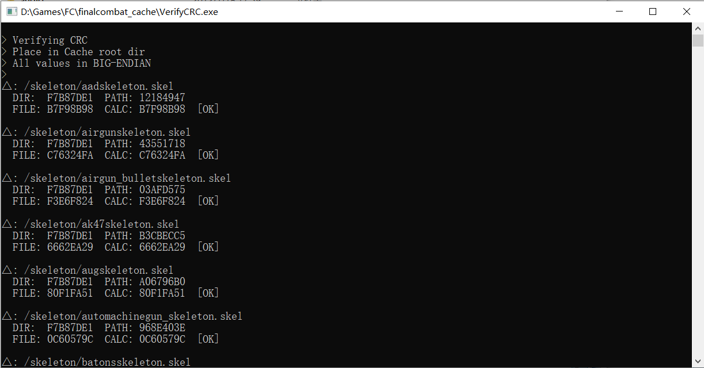

    可以计算出文件中的校验码
        需使用 UnPdeC生成.cache文件才能进行校验！
        需要将 VerifyCRC.exe 放在与 xxx-cache 根目录下，
        这样做的目的是为了确定确定根目录以便计算校验码!
    
    比如将 目录 或 文件 /mesh/scene/level1/scene.mesh.cache 文件拖入 VerifyCRC.exe 上，即可得到校验码是否正确！
    或者计算出正确的校验码!

    DIR: 文件所在目录的校验码
    PATH: 完整路径的校验码
    FILE：文件中记录的校验码
    CALC: 计算出的校验码 

    也可以通过校验结果来判断这个文件是不是在这个目录中的！
    如果不是，那么计算出的结果则和文件中的不匹配！
    可以说这个CRC很有意思！

### [VfsTableDumper.exe](Src/VfsTableDumper/)
    根据.pde文件的堆叠逻辑，
    可以用此工具将VFS表数据整合导出为一个完整的VFS表文件！

    堆叠的逻辑可以看下面关于VFS表的分析！

---

## 🎄 C#辅助工具

### [HlslDecompiler](https://github.com/AndresTraks/HlslDecompiler) by:AndresTraks
    用于将Shader文件(.pd9 .vd9)反编译为HLSL代码
    不过目还有少部分文件无法反编译！
    编译后使用命令行 HlslDecompiler.exe xxx.pd9 即可反编译！

### [Unpde - 即将被淘汰](Src/Unpde/)
    UnPdeC 的前身！已经很久没更新了!
    很感谢这个程序，学到了很多有趣的东西！

    使用AI将UnPdeC的逻辑翻译为C#语言！
    目前没啥大问题！功能与UnPdeC大体一致！

### [PDEView](Src/PDEView/)
    WPF GUI版本的PDE文件浏览器
    可以可视化浏览.pde/.xor文件内容
    支持单文件或批量导出
    自动解压缩.cache和.lua文件

### [PDEPack](Src/PDEPack/)
    将资源目录打包为.pde文件
    拖入目录即可生成对应的.pde文件

### [ReCache](Src/ReCache/)
    将普通文件打包为.cache文件
    自动计算CRC32校验值
    需要选择资源根目录和参考文件

### FCM
感谢 B站大佬 [Crow_Lz](https://space.bilibili.com/358659452) 提供的矩阵逻辑~

万分感谢👍👍👍

没有大佬的矩阵逻辑,就没有这个工具!

    控制台版smd转换器
    用于将mesh skel anim 转换成smd格式！
    这个是为了快速测试用的！
    使用时需要手动修改硬编码的 mesh skel anim 文件路径！

    smd格式可以使用 Noesis 查，在下方可以看到下载地址！

### FMC2
感谢 B站大佬 [Crow_Lz](https://space.bilibili.com/358659452) 提供的矩阵逻辑~

万分感谢👍👍👍

没有大佬的矩阵逻辑,就没有这个工具!

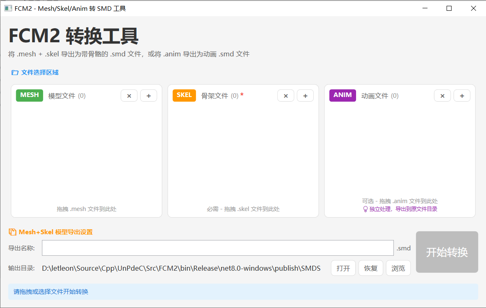

    WPF GUI版本的smd转换器
    用于将mesh skel anim 转换成smd格式！
    推荐使用这个！

    smd格式可以使用 Noesis 查，在下方可以看到下载地址！

### [PDELuac](Src/PDELuac/)
    WPF GUI版本的Lua编译器
    将明文Lua编译为.luac字节码
    可选添加PDE 8字节头部
    需要 luac_dll.dll

---
## Go语言辅助工具

### [UnPdeGo - 即将被淘汰](Src/UnPdeGo/)
    使用AI将UnPdeC的逻辑翻译为Go语言！
    目前没啥大问题！功能与UnPdeC大体一致！

    Go语言语法简洁，性能也不错。

---

## 🌏 HTML辅助工具 - 用于快速获取一些数据

### 1. [FastXOR.html - 在线快速异或](Src/Html_Tools/FastXor.html)
    快速在网页中异或原始字节
    需要注意的是XOR KEY的大小是0x1000，
    不是单个字节的数据去异或的，所以你只能从数据的开始复制！

    比如使用HxD打开原始的.pde文件，定位到0x1000位置
    这个位置是根目录的位置，记录了根目录下有哪些文件夹和文件！
    你只能从0x1000 开始复制，因为这是一个块，
    不能从0x1000 以后的字节开始复制，
    不然粘贴到FastXOR.html中，异或后的结果是不正确的！！！

### 2. [OffsetCalc.html - PDE偏移值计算器](Src/Html_Tools/OffsetCalc.html)
    可以将加密的文件或文件夹偏移值转换为实际偏移地址
    (需要小端的值！！！)
    也可以将实际的偏移地址转换为回加密的偏移地址

### 3. [XorShiftOffset.html - 文件偏移模糊计算器](Src/Html_Tools/XorShiftOffset.html)
    由于异或的大小是0x1000
    那么就可以计算出在某个位置下你需要的值被加密后的值是多少

### 4. [HEXVIEW.html - 生成博文中需要的16进制](Src/Html_Tools/HEXVIEW.html)
    用于生成博文中需要的16进制数据(HxD Style)
    OFFSET    00       04       08       0C        ASCII
    00000000  55736564 20746F20 67656E65 72617465  Used to generate 
    00000010  20746865 20686578 61646563 696D616C   the hexadecimal 
    00000020  20646174 61206E65 65646564 20696E20   data needed in  
    00000030  626C6F67 20706F73 7473               blog posts

### 5. [HalfFloatToUV.html - 半精度浮点数计算器](Src/Html_Tools/HalfFloatToUV.html)
    用于将半精度浮点数转换为UV坐标

### 6. [IEEE754.html - IEEE754浮点计算器](Src/Html_Tools/IEEE754.html)
    用于快速计算.mesh .anim .skel文件中的浮点数
    增加了半精度浮点数计算的功能

### 7. [DumpMeshBoneName.html - .MESH骨骼索引名称提取](Src/Html_Tools/DumpMeshBoneName.html)
    用于提取.mesh文件中的骨骼名称

### 8. [DumpAnimBoneName.html - .ANIM骨骼索引名称提取](Src/Html_Tools/DumpAnimBoneName.html)
    用于提取.anim文件中的骨骼名称

### 9. [DumpSkelBoneName.html - .SKEL骨骼索引名称提取](Src/Html_Tools/DumpSkelBoneName.html)
    用于提取.skel文件中的骨骼名称

---

## 🎃Blender插件

### [PDEModelTools - PDE模型工具](Src/PDEModelTools/)
    可以解析 .mesh 文件，并自动导入贴图(需要先设置资源根目录)
    目前还在探索 正确解析 .skel .anim 文件！也就是骨架和动画文件！
    建议使用 Blender 4.5+

### [Addon Reloader - 快速重新加载Blender插件](https://github.com/0xletleon/AddonReloader)
    快速重新加载Blender插件
    无需进入设置手动禁用在启用
    适合开发调试Blender插件时使用
    Blender 4.5+

### [Blender Development - 开发Blender插件的VSCode插件](https://marketplace.visualstudio.com/items?itemName=JacquesLucke.blender-development)

    这是一个VSCode插件！
    用VSCode打开项目后，
    按快捷键 F1，
    输入 Blender: Build and Start
    之后选择Blender.exe的路径
    即可调试插件！
---
## 💻Windows辅助工具

### [FixRightClickLimit.reg - 修复Windows右键菜单限制](Release/FixRightClickLimit.reg)
    修复右键菜单限制
    在多选.cache文件时右键没有打开选项时
    可以使用这个来解除选择很多文件时
    右键没有 打开 选项的问题！

---
## 🖼️🎵 资源预览工具

### [TacentView](https://github.com/bluescan/tacentview)
    DDS/TGA预览工具

### [FSB Extractor](http://aezay.dk/aezay/fsbextractor/)
    FSB音频提取工具。

### [FMOD Designer](https://www.fmod.com/download#legacy)
    .fsb .fev 格式文件生成工具,这是fmode官方给的工具！
    内置了一个 FMOD Event Player 可以打开 .fev文件
    可以查看和播放其中的声音！

    FC 1.0.1.9920 用 v4.32.09！
    其他版本用最新版本！

### [Clean Flash Player](https://gitlab.com/cleanflash/installer)
    干净的Flash播放器，可以用来播放.swf文件

### [Noesis](https://www.richwhitehouse.com/index.php?content=inc_projects.php&showproject=91)
    3D资源查看器/转换器

### [NVIDIA Texture Tools Exporte](https://developer.nvidia.com/texture-tools-exporter)
    NVIDIA 纹理工具导出器 独立程序
    
    可用配置 - 保存为 .dpf 文件加载配置即可！
    DXT1_BC1_NOMIPS.dpf - 登录背景图测试可用
    --format bc1 --quality normal --no-mips --zcmp 5

---

## 客户端

包含国内和国外的历史客户端！

[123网盘连接](https://www.123684.com/s/b5Y0Vv-rN4J3)

[123网盘备用连接](https://www.123pan.com/s/b5Y0Vv-rN4J3)

---

## 奇怪的地方

### 奇怪的名字

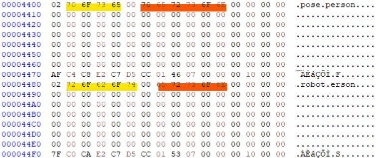

    正常来说文件名后面是00的话文件名就结束了
    有几处会出现00后面还有字符串的情况

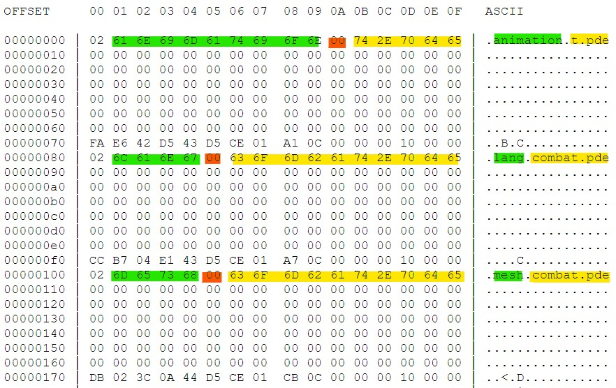

    在某更新补丁内找到了相同的情况
    看样子应该是被复用了
    程序只读到00就结束了
    所以不影响

### 奇怪的名字2
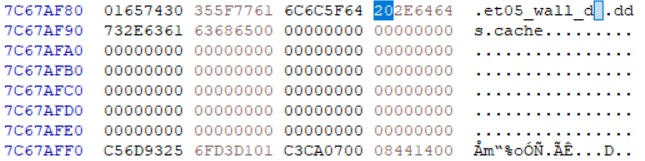

    居然在文件名后面加了个空格(0x20)
    导致被判断为没有.cache后缀的文件，
    被直接导出了！😹

### 奇怪的名字3
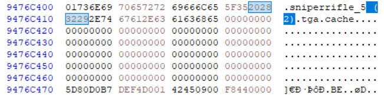

    这个名字中有
    空格(0x20)
    左括号(0x28)
    右括号(0x29)

### .pde文件中的Key
    在UnPde项目中的 PdeKey.cs 文件中我是这样描述的！
        // 版本 1.0.1.9920 KEY位置(每个位置的值都一样)
        // 101E1000 10263000 2708F000 275BD000 27A3E000
        // 版本 1.0.6.7960 KEY位置(每个位置的值都一样)
        // CE25000 1C9CF000 29F40000 ...还有21个
    
    但实际上是巧合。
    "异或同一个数两次会归零，所以第一次的结果就是密钥。"
        解释：若 A ^ B = key，那么 key ^ key = 0，因此 key 就是最初的异或值。
    所以能搜索到很多大小为0x1000的0x00000000数据块！
    这些数据块实际上是某个文件尾部数据空间的空白值。
    这很有趣。
