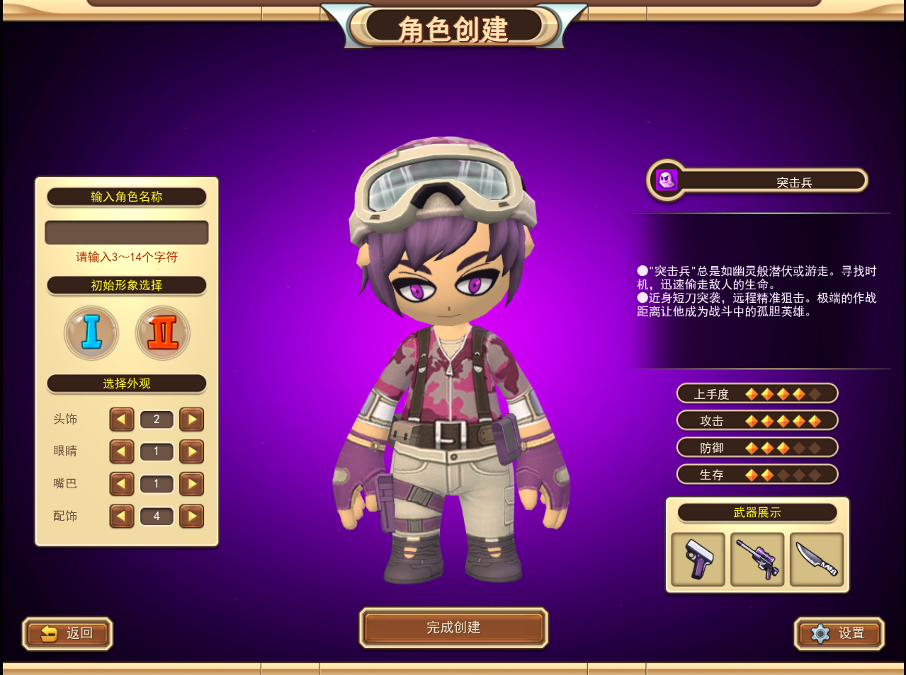
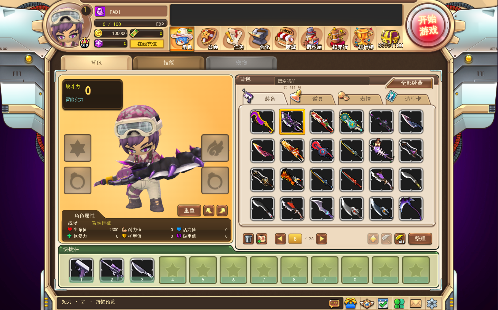
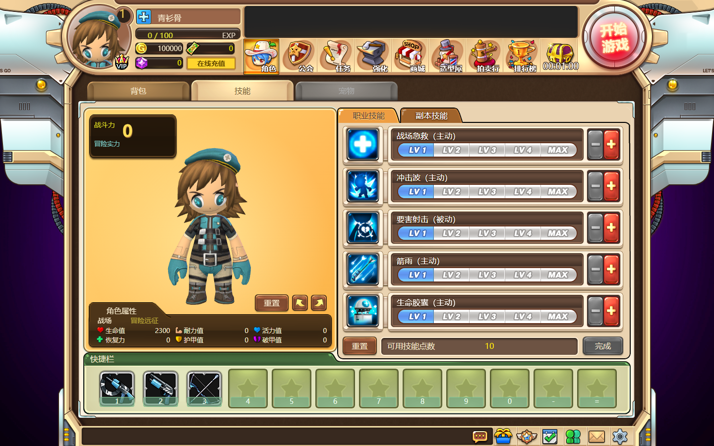
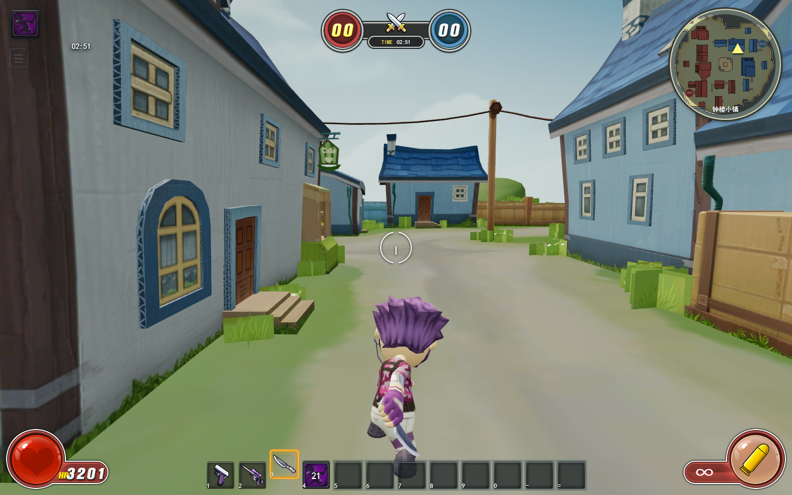
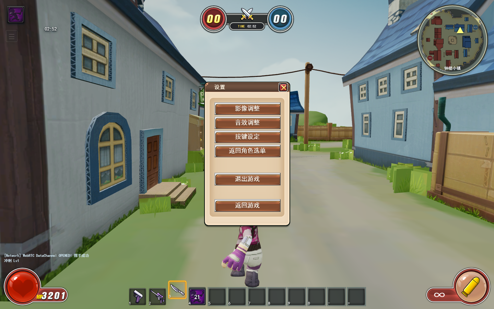

# AvatarStar 浏览器客户端

```bash
npm install
npm run dev
```

从 `/` 的职业选择页点击「开始创建」，完成后自动进入 `/lobby` 大厅。也可以直接访问 `/create-character?job=assassin`。支持 `guardian`、`gunner`、`assassin`、`biochemist` 四个职业，以及各自的男女模型；刷新大厅会恢复本地保存的角色。



## 角色创建

界面以 `AvatarStar_cache/scripts/select_character.lua` 的 1200×900 坐标为基准，等比适配窗口。面板、按钮、职业背景、图标、字体、武器和背景光点均来自缓存。九宫格边距来自 `scripts/sys/skinF.lua`，职业属性和可用介绍来自 Lua。

中间使用 Three.js 加载 `GameMesh` 中由 PDEModelTools 转换的 GLB。角色部件按骨骼名称重映射到同一套骨骼，保留网格和蒙皮权重；服装使用原始 DDS 图层合成，发色等通过 `_m.dds` 遮罩着色。支持拖动旋转、男女形象、头饰/眼睛/嘴巴/配饰切换。男突击兵默认选项为创建截图中的 `2 / 1 / 1 / 4`，女突击兵默认使用大厅截图的紫色双马尾。

职业切换会更换整套资源：护卫兵使用 guardman/guardwoman，重装兵使用 heavyman/heavywoman，突击兵使用 malecommandos/femalecommandos，生化专家使用 shenghuanan/shenghuanv。快速切换时会清理旧场景，避免过期的加载结果覆盖新角色。

待机使用原始 `idlea.anim`。选择武器后，加载武器 Lua 指定的网格、骨骼挂点与 `stdidlemenu.anim` 持握动作；再次点击收起武器。设置弹窗支持音量和待机动作开关、Esc 关闭与键盘焦点约束。

## 大厅与背包



大厅依据 `scripts/lobby/lobbyMain.lua`、`personalInfo.lua` 和 `scripts/sys/skinF.lua` 布局，复用原始大厅边框、顶部导航、物品图标、背包面板和快捷栏素材。左侧及顶部头像显示创建时保存的角色。

背包默认开放缓存中的全部 1,208 个条目：611 件装备、569 件道具、14 个表情和 14 个造型条目（包含 8 个本地职业形象）。每页 24 格，支持分类、搜索、翻页和整理，不依赖服务端发放物品。

- 点击 484 件可关联武器 Lua 的装备，加载对应网格、挂点和原始持握动作。背包底部的上箭头、锤子、ALL 按钮分别预览攻击、装填、恢复持握；悬停可查看提示。
- 35 个翅膀条目可预览模型，保留独立骨骼并挂到角色胸骨，校正角色与翅膀的骨骼坐标。翅膀播放自身待机片段，共享骨骼的变体复用对应骨骼动作；存在 `showidle` 时，同时播放角色的展示动作。
- 表情播放原始动作，造型条目切换预览职业和性别；「重置」恢复创建时的角色。
- 拖动物品到快捷栏，或选中物品后点击空快捷格分配；按 `1`～`0`、`-`、`=` 预览，右键清空快捷格。快捷栏在当前大厅会话内保留。
- 模型支持拖动及左右按钮旋转；设置支持音量、动作开关和返回职业选择。

部分戒指、徽章和其他图标缺少可确认的三维关联，仍完整列在背包中，并明确显示没有对应预览资源。139 个动画由 PDEModelTools 的 `.anim` 解析器导出，保持原始 60 fps 采样；恒定轨道仅保存一帧和完整时长。喷射器的原始射击片段是固定姿势，喷射特效尚未接入。

## 技能面板



「技能」标签按 `personalInfo.lua` 的 `right_main_3` / `profession_skill` 与 `ComFuc.SkillPointItem` 布局：592×508 面板、两个 127×31 分类按钮、五行 568×83 技能条（图标 70×70、名称 300×21、等级条 364×31、加减按钮 32×60），底部是重置、可用技能点数与完成。皮肤来自 `skinF.lua`：面板 `skill_jineng_ditu_01`、技能条 `skin_common_background23_02`、等级条底色 `skin_common_skill01`、已确认 `skin_common_skill02`、临时分配 `skin_common_skill03`、加减按钮 `skin_common_skill_plus/minus_*`、分类按钮 `skin_common_button5_*`、技能点条 `skin_common_pagebar_BG`、副本卡 `skin_pet_bg03/05`、分隔线 `skin_jineng_hengxian_01`；技能图标复用 `ui/skinF/lobby/<resource>.tga` 与 `<resource>_disabled.tga`。

等级条保持原逻辑的两层：`skill_size_` 显示已确认等级（蓝），`skill_size_v_` 显示临时分配（青），都覆盖在灰色底色上。点「+」预分配点数、点「-」退回，「完成」写入等级，「重置」把全部技能退回 0 级并返还点数；主动技能达到 1 级后可拖入快捷栏，悬停显示等级说明。

离线没有服务端发放的技能点与副本技能，所以按四张职业截图的展示初值：每个职业技能默认 1 级、共 15 点、剩余 10 点，界面与截图一致；「副本技能」保留 6 个 `BossSkillShow` 卡位，显示「未获得」并提示需要连接服务器。截图中的「可用技能点数」与原服文案「剩余技能点数」不同，这里跟随截图。

技能名称、主动/被动与图标来自 `game_text.lua` 的 `tips_abilities_*` 和缓存图标；等级说明取同一组键的 `mode1`～`mode5`。生化专家的五个技能在这份缓存里没有对应文本，只保留截图中的名称。`skills.json` 描述四个职业的技能表，`catalog.json`、`sources.json` 记录面板皮肤与图标来源。

## 局内战斗



「开始游戏」→「练习赛」→ 创建房间后进入战场。局内 HUD 复用缓存的 `skin_ingame_*` 素材：顶部红蓝计分与 TIME、左下生命球、右下弹药盘、右上圆形小地图，以及底部的 12 格物品栏。

- 物品栏逐格镜像大厅快捷栏，只显示大厅装入的武器和主动技能，其余格子留空；按 `1`～`0`、`-`、`=` 直接切换武器或释放技能，也可以点击格子。
- 主动技能按当前等级读取 `skills.json` 的等级说明（治疗量、有效半径、冷却时间、持续时间等）作为数值；冷却期间图标变暗并显示读秒。被动技能折算成伤害减免、暴击、暴击伤害、吸血、瘟疫、毒伤等战斗加成。
- 近战武器（短刀、盾、棍）长按鼠标左键连续出招，按缓存里的 `stdshoot1/2/3` 依次切换攻击动作，停手 1.2 秒后连招重头开始；枪械类长按则按各自射速自动射击，`R` 装填。
- 进入战场即请求鼠标锁定；`Esc`（或鼠标被释放）弹出大厅同款设置界面暂停，关闭设置后重新锁定。
- 局内设置直接复用大厅的 `SettingsMenu`：影像调整、音效调整、按键设定、返回角色选单、退出游戏、返回游戏。



房间开始依赖服务端广播的 `start_game`，客户端同时轮询房间状态，避免 Redis 订阅竞态让「开始游戏」没有反应。缓存里没有 `player_create` 与服务端技能点，所以房间和角色仍由本地生成，技能按面板的展示初值生效；其他玩家的移动与命中判定通过 `cxbt-server` 的 WebSocket 转发。近战连击片段由 `prepare-gameplay-animations.mjs` 从缓存的 `.anim` 导出，只有自带的近战武器集（12 套）含 `stdshoot2/3`，其余武器沿用各自的射击动作。

## 素材生成

在仓库根目录运行，依赖 Python 的 Pillow、NumPy，以及 Blender 4.5+：

```bash
python3 cxbt-client/scripts/prepare-creation-assets.py
blender -b --factory-startup --python-exit-code 1 --python PDEModelTools/export_creation_animation.py
python3 cxbt-client/scripts/prepare-lobby-assets.py
blender -b --factory-startup --python-exit-code 1 --python PDEModelTools/export_lobby_animations.py
blender -b --factory-startup --python-exit-code 1 --python cxbt-client/scripts/prepare-skill-assets.py
node cxbt-client/scripts/prepare-gameplay-animations.mjs
```

输出为 `public/assets/creation/`（约 53 MiB）与 `public/assets/lobby/`（约 330 MiB）。`config.json` 描述创建资源，`catalog.json` 描述背包及装备预览，`sources.json` 记录图片与模型来源；每个动画 JSON 同样包含原始 `.anim` 路径。页面只加载当前预览所需的模型与动画。生成流程保持 `AvatarStar_cache` 和 `GameMesh` 不变；背景音乐复用 `public/assets/character-selection.ogg`。

`prepare-gameplay-animations.mjs` 解析 `AvatarStar_cache/animation/character/thirdperson/male/<武器集>/` 下的 `.anim`，为已导出的近战武器集补齐 `-attack2`、`-attack3`（来自 `stdshoot2/3`）与 `-spurt`（来自 `stdspurt1`）连击片段，写入 `public/assets/gameplay/animations/`；已存在的片段保持逐字节不变。

在无声卡的 Linux 环境，可为 Blender 设置 `ALSOFT_DRIVERS=null SDL_AUDIODRIVER=dummy`，避免音频服务导致后台进程退出等待。

## 验证

在 `cxbt-client/` 运行：

```bash
npm run lint
npm run build
# 先启动 Vite；需要 Node 22+ 和 Chromium
npm run smoke:creation -- http://127.0.0.1:5173
npm run smoke:skills -- http://127.0.0.1:5173
npm run smoke:battle -- http://127.0.0.1:5173
```

可用 `CHROMIUM_PATH` 指定 Chromium。测试实际加载 WebGL，覆盖创建时的外观切换、四职业八种形象、武器、旋转、名称校验，以及进入大厅、本地角色恢复、全量背包分页、14 类武器的持握/攻击/装填、翅膀独立骨骼、表情、造型卡、快捷栏、快速切换和不同窗口尺寸，同时检查浏览器异常及 HTTP 错误。截图写入运行结果打印的 `/tmp/avatar-creation-smoke-*` 目录。

`smoke:skills` 覆盖四个职业的技能面板：技能表与名称、初始等级与「可用技能点数」、加/减与完成/重置后的两层等级条、主动技能拖入快捷栏、副本技能占位卡，以及浏览器异常与 HTTP 错误。

`smoke:battle` 需要同时运行 `cxbt-server`（`http://localhost:8081`）：测试用固定令牌的临时账号写入角色并创建练习赛房间，进入战场后检查物品栏镜像大厅快捷栏（12 格、3 把武器、1 个技能、8 个空位）、技能热键释放与冷却读数、长按左键的近战连招段数、进入战场后的鼠标锁定，以及 `Esc` 打开的大厅设置界面，最后检查浏览器异常与 HTTP 错误。截图写入运行结果打印的临时目录。

PDEModelTools 扩展已在 Blender 5.2.2 中构建并通过 `extension validate`。另外抽查导入了身体、头部和护目镜发型，确认 68 根骨骼、蒙皮与静止姿态渲染正常；大厅新增抽查 wing01、wing23、wing45 的骨骼、蒙皮和纹理渲染。35 个翅膀的动画轨道均与独立骨骼匹配。动画通过相同解析器导出，在浏览器中检查实际蒙皮与持握效果。

## 离线复原范围

缓存没有原服 `sysavatar_list` 返回的完整外观组合、颜色和部件变换，也没有 `player_create` 服务。八种职业外观使用已确认的游戏部件，配色、面部贴图布局和耳朵位置为本地重建参数。生化专家的原版介绍文本在这份缓存中缺失。

「完成创建」校验 3～14 个 Unicode 字符，将名字、职业和外观保存到当前浏览器的 `localStorage['avatarstar.character']`，随后进入大厅。物品展示以本地素材目录为准；缺失的正式名称用资源分类及编号标识，货币与属性是参考画面的展示初值。账号、公会、商城、充值及开始对局等入口尚未连接游戏服务器，点击会说明当前支持范围。
